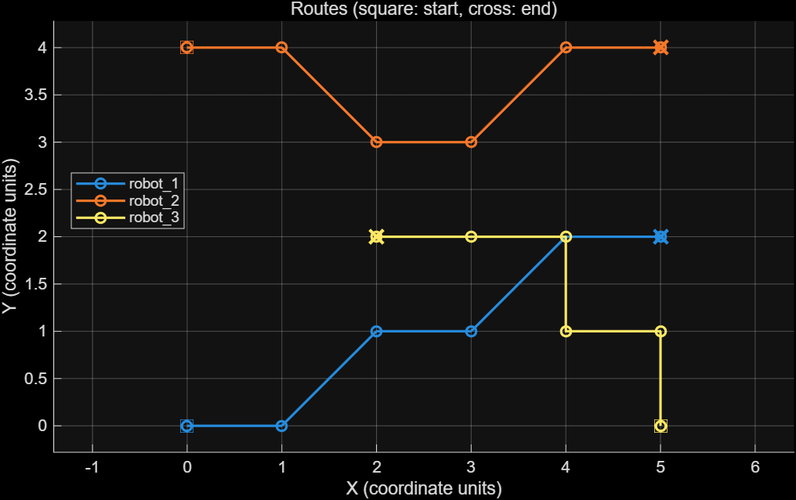

# MATLAB Multi-Robot Route Visualizer

A MATLAB desktop interface for displaying supplied 2D robot routes, inspecting sample interval speeds, and importing or exporting route data and plots.

This project was developed as part of an undergraduate student innovation project.

## Features

- Display multiple robot routes in a shared planar coordinate frame.
- Mark route starts with squares and ends with crosses.
- Plot average speed over each sample interval.
- Inspect route samples and calculate path length, duration, and mean speed.
- Import validated CSV data and export the current routes or a PNG plot.

The application visualizes supplied routes. It does not perform automatic path planning, obstacle avoidance, inter-robot collision detection, real-time sensing, or robot control. Demo routes may intersect.



## Quick Start

Requires MATLAB R2021a or later. No additional toolboxes are required. See the testing section for the verified environment.

Open the project root as the MATLAB current folder and run:

```matlab
app = run_demo;
```

The interface loads three example routes automatically. Use the figure toolbar to zoom, pan, or inspect data points.

| Button | Action |
| --- | --- |
| Load demo | Restore the example routes. |
| Import CSV | Validate and replace the displayed routes. Invalid input leaves the current data unchanged. |
| Export CSV | Save the current route samples. |
| Export PNG | Save the route plot only. |

## CSV Format

The following columns are required. Additional columns are ignored and are not included in exports.

```csv
robot_id,time_s,x,y
robot_1,0,0,0
robot_1,1,1,0
robot_2,0,0,3
robot_2,1,1,3
```

- `robot_id`: a nonempty robot identifier.
- `time_s`: a finite, nonnegative timestamp in seconds.
- `x`, `y`: finite real coordinates in a shared planar frame.

All routes must use the same coordinate units. For coordinates in meters, speed is reported in meters per second. Geographic coordinate projection and geodesic distances are not supported.

Samples are sorted by robot identifier and time. Timestamps must be distinct within each robot's route. A single-point route has zero length, no speed curve, and a mean speed of NaN.

Interval speed is the straight-line distance between adjacent samples divided by their time difference, displayed as constant over that interval. It is not a measurement of instantaneous speed.

## Programmatic Usage

```matlab
app = run_demo('Visible', 'off');
app.importCSV(fullfile('examples', 'demo_routes.csv'));
stats = route_summary(app.Routes);
app.exportCSV('routes.csv');
app.exportPNG('routes.png');
delete(app);
```

`route_summary` returns each robot's sample count, polyline path length, elapsed time between the first and last samples, and mean speed.

## Testing

From the project root, run:

```matlab
results = runtests('tests');
assertSuccess(results);
```

All three automated tests passed on Windows with MATLAB R2025a. They cover input validation, sorting, geometric statistics, interface creation, CSV round trips, PNG export, and preservation of current data after an invalid import.

The compatibility target is R2021a or later; earlier supported releases have not been individually verified. Interactive file selection dialogs have not been separately tested manually.

## Project Structure

```text
run_demo.m            Application entry point
src/                  Interface, validation, and route statistics
examples/             Three-robot sample CSV
tests/               MATLAB automated tests
docs/                Preview image
```

## License

All rights reserved. No permission to modify or redistribute is currently granted.
